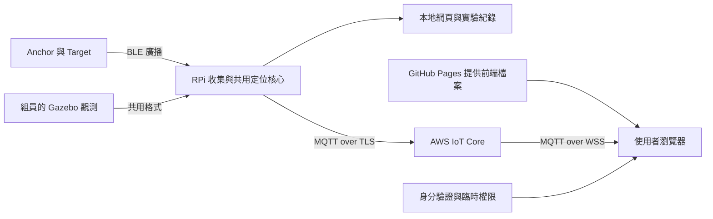

# 架構候選方案

狀態：需求訪談中。GitHub Pages＋AWS 即時顯示、即時資料登入觀看、公開唯讀及本地歷史保存已確認；服務與介面細節待實作設計，尚未部署。

## GitHub Pages、RPi 與 AWS 可以串接

- RPi 接收 BLE、做兩階段定位，保留本地成果，並可將結果發布到 AWS。
- GitHub Pages 提供 HTML／CSS／JavaScript；瀏覽器下載前端後，直接連 AWS 訂閱結果。
- GitHub Pages 不需替 RPi 開放對外連線，RPi 與瀏覽器各自主動連 AWS。
- AWS IoT Core 支援 MQTT 與 MQTT over WSS；候選設計為 RPi 使用裝置 X.509 憑證，瀏覽器以 Cognito 臨時身分及 SigV4 建立 WSS。
- 公開端已確認唯讀；IAM 與 IoT 權限限定在本專題的指定 topic。開始／結束巡查只在 RPi 本地操作。
- 即時資料需登入，預定使用受邀帳號；展示回放免登入。具體帳號建立與邀請機制待落實。
- 長期 Access Key、RPi 裝置私鑰不可寫入前端；公開前端可含必要的非機密連線設定。
- 每秒推送目前狀態；資料保存與回放已確認由 RPi 的紀錄匯出支援。新開頁面取得首筆狀態與斷線顯示細節待定義；單純即時訂閱不等於歷史儲存。

## 即時與歷史分開決定

第一版即時呈現採 IoT Core 方向；完整歷史保存在 RPi，網頁匯入匯出紀錄回放，第一版不要求雲端歷史查詢。未來若需雲端歷史，可再評估課文的 IoT Rules → DynamoDB；目前不因課文出現服務就全部建立。

本地功能須在未接 AWS 時仍可運作。公開即時方案已納入第一版；先前「公開只做回放」的建議未被採用。

專用網頁統一呈現，Node-RED 不列必要交付。AWS 斷線時本地流程繼續，公開端顯示中斷與最後有效資料；恢復後發布最新狀態，第一版不補傳全部歷史紀錄。

## 零費用條件

使用者已建立 AWS Free Plan；額度與期限證據存於本地 artifacts/account，不隨公開程式庫發布。所需服務可用性及部署當時額度仍需核對。

- Free plan 與 Paid plan 的計費行為不同，服務可用性亦需逐項核對。
- 在免費資格與專題用量未核對前，不宣稱此方案已符合 0 元，也不建立雲端資源。
- 用量與資料更新頻率在訪談後定義，再依官方費率與帳號額度估算。
- 如方案無法滿足零費用，保留本地展示並回到架構取捨，不自行放寬預算。

## 官方參考

- [GitHub Pages：靜態網頁託管](https://docs.github.com/en/pages/getting-started-with-github-pages/what-is-github-pages)
- [AWS IoT Core：協定與驗證](https://docs.aws.amazon.com/iot/latest/developerguide/protocols.html)
- [AWS IoT Core：Pub/Sub 權限範例](https://docs.aws.amazon.com/iot/latest/developerguide/pub-sub-policy.html)
- [AWS：Free 與 Paid plan](https://docs.aws.amazon.com/awsaccountbilling/latest/aboutv2/free-tier-plans.html)

查核日期：2026-11-26。
