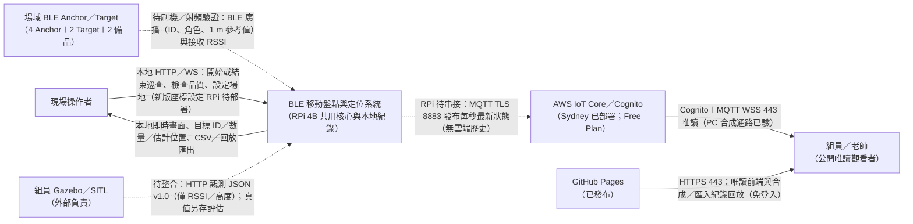

# 第一層：系統全景

圖例與狀態說明：

- **實線箭頭（`-->`）**：已實作且具軟體／本機或公開頁驗證證據之路徑（見 `TEST-004`、`TEST-010`、`TEST-011`、`TEST-012`、`TEST-013`）。
- **虛線箭頭（`-.->`）**：尚待硬體刷機、雲端部署或外部組員整合之路徑（見 `HW-001`、`SIM-001`、`CDX-CLOUD`）。
- **系統邊界**：系統方塊刻意不展開內部模組，呈現使用者、感測／模擬輸入與外部服務。具 WGS84 地理參考時，前端另可向 OpenStreetMap 取得公開底圖圖磚（選用；失敗或無地理參考時退回 Local 網格）。
- **部署差異**：RPi 目前運行 `0bdeea4` 服務（`TEST-010`）；新版座標設定已在本機驗證，因 SSH 逾時尚待部署至 RPi。六塊 XIAO 刷機與各別 Windows BLE 解碼通過（TEST-021–026）；AWS Sydney 部署及 PC 合成通路通過（TEST-027），RPi 同時收包與定位仍待驗。
