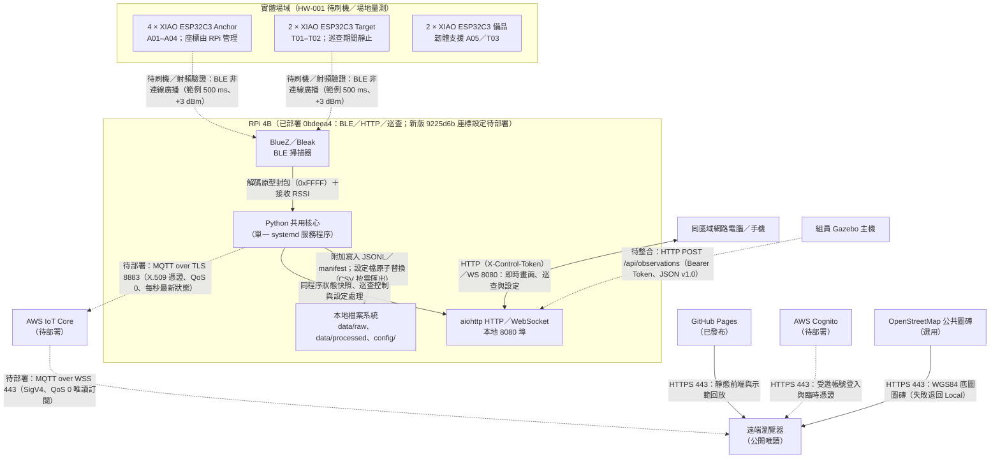

# 第二層：軟硬體部署與通訊

圖說與部署狀態：

- **實線／虛線約定**：實線代表已實作並具本機／CI／既有機台驗證之路徑；虛線代表尚待刷機、雲端部署或外部整合之路徑。
- **網路邊界**：本地 HTTP／WebSocket（8080 埠）僅供同區域網路使用，不直接對網際網路開放；跨網路觀看改走 AWS 加密通道（TLS 8883 與 WSS 443），且公開瀏覽器僅能唯讀訂閱或檢視回放，無遠端巡查控制與座標修改權限（`TEST-013`）。
- **現況差異**：RPi 4B 已驗證 `0bdeea4` 之 `systemd` 服務、HTTP 200 與 BlueZ 掃描（`TEST-009`、`TEST-010`）；新版座標設定介面（`9225d6b`）已在本機驗證（`TEST-011`、`TEST-012`），因 RPi SSH 逾時尚未傳檔部署。XIAO 僅完成六種角色編譯（`TEST-006`），未刷機；AWS 僅完成模板與離線 preflight（`TEST-007`），未建立雲端資源。
