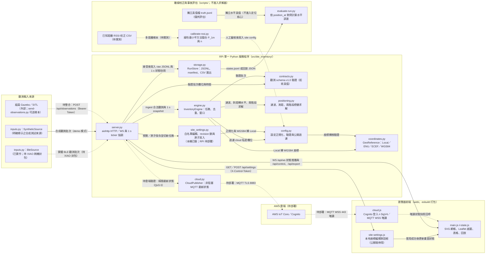

# 第三層：軟體技術棧與模組分工

圖說與邊界說明：

- **單一程序結構**：`RPi 單一 Python 服務程序` 內的所有模組由 `cli.py` 啟動並在同一個 `aiohttp` 程序內執行，`server.py` 負責協調輸入、`engine.py`、`storage.py`、`site_settings.py` 與 `cloud.py`；`engine.py` 本身不直接相依於檔案寫入、HTTP 或 MQTT，亦不把各檔案拆分為獨立微服務。
- **儲存與雲端範圍**：持久化全部以本地檔案系統（`observations.jsonl`、`states.jsonl`、`manifest.json`、設定檔與私密備份）完成；第一版未部署 EC2、DynamoDB 或雲端歷史資料庫。
- **真值隔離**：`contracts.py`（搭配 `src/contracts/observation.schema.json`）以白名單欄位拒收任何真值座標；`truth.jsonl` 僅進入事後評估腳本 `scripts/evaluate-run.py`。
- **狀態說明**：`site_settings.py` 與 `web/site-settings.js` 已通過本機自動化與瀏覽器驗證（`TEST-011`、`TEST-012`），公開頁確認停用編輯（`TEST-013`），RPi 新版尚待部署；Gazebo、實體 XIAO 校正與 AWS 仍待外部交付或實測部署。
