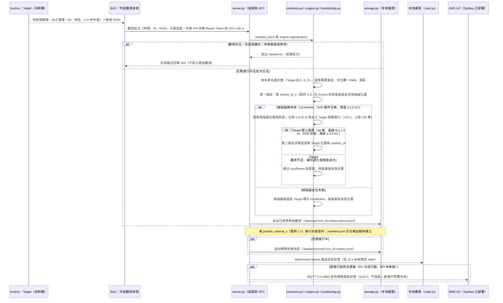
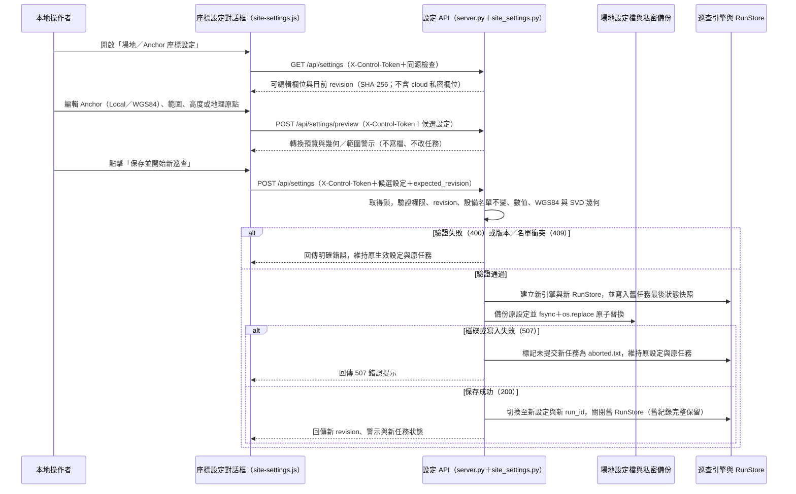

# 第四層：關鍵流程序列

## 巡查觀測與定位

## 座標設定切換（本地已驗證，RPi 新版待部署）

圖說與驗證狀態：

- **定位與真值邊界**：Target 去重計數（$S_R$）發生在合法觀測進入名單核對之後，即使當下 Anchor 不足而無法定位掃描器，已收到的 Target 仍計入本次已盤點（見 `tests/test_engine.py:test_missing_anchors_no_fabricated_solution`）；真值資料絕不進入本序列之定位核心。
- **設定交易狀態**：本地數值、交易失敗回復（`400`/`409`/`507`）、API 與桌面瀏覽器操作已通過 `TEST-011`、`TEST-012`，公開頁已確認停用設定編輯（`TEST-013`）；RPi 新版更新因 SSH 逾時尚待部署（`ISSUE-010`），最終報告須保留此部署差異，待現場複驗後再更新。
